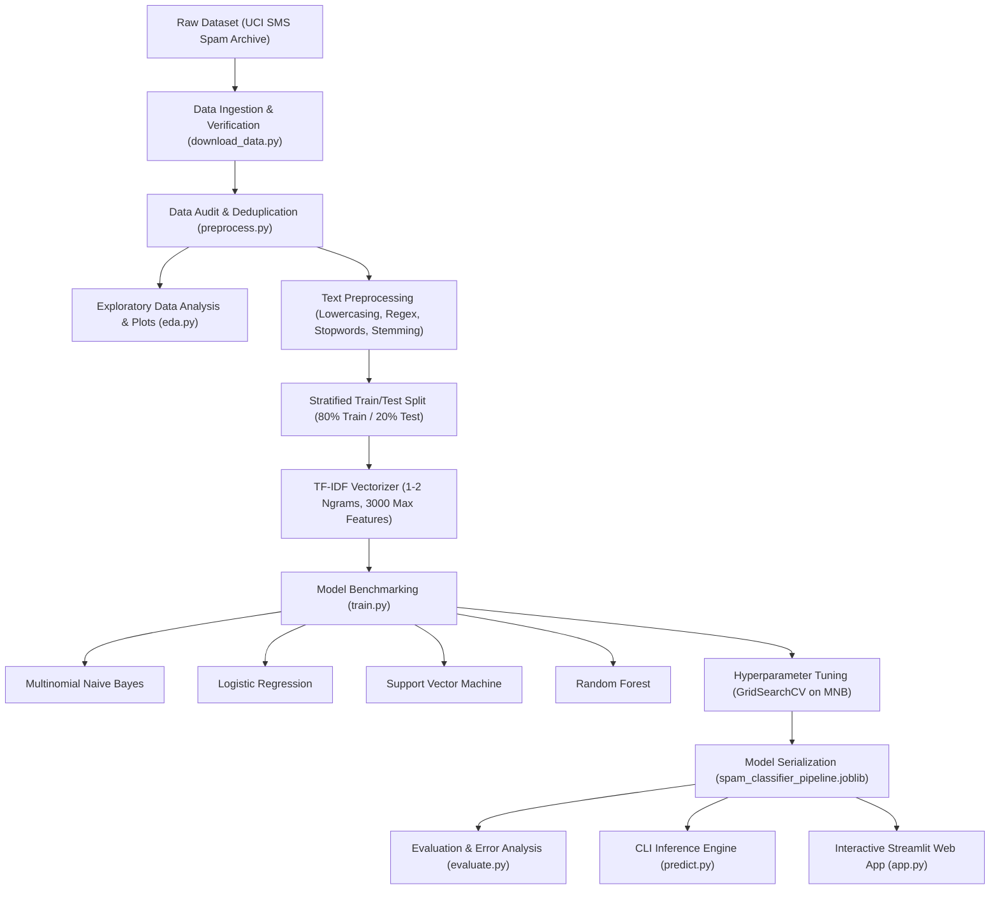

# 🛡️ Email & SMS Spam Classification Using Machine Learning

[](https://www.python.org/)
[](https://scikit-learn.org/)
[](https://streamlit.io/)
[](LICENSE)

An end-to-end, production-grade, beginner-friendly Machine Learning project that classifies messages as **Spam** (unsolicited, fraudulent, or promotional) or **Ham** (legitimate personal or professional communication).

Designed for college students and aspiring Machine Learning Engineers to understand the full ML lifecycle, explain algorithms during technical interviews, and showcase a complete project on their resumes.

---

## 📑 Table of Contents
1. [Project Overview & Key Highlights](#-project-overview--key-highlights)
2. [Dataset Information & Auditing](#-dataset-information--auditing)
3. [System Architecture](#-system-architecture)
4. [Machine Learning Workflow](#-machine-learning-workflow)
5. [Actual Experimental Results & Benchmarks](#-actual-experimental-results--benchmarks)
6. [Why Precision is the Critical Metric](#-why-precision-is-the-critical-metric)
7. [Error Analysis (False Positives & False Negatives)](#-error-analysis)
8. [Installation & Execution Guide](#-installation--execution-guide)
9. [Streamlit Web Application](#-streamlit-web-application)
10. [Google Colab Instructions](#-google-colab-instructions)
11. [15+ Technical Interview & Viva Questions](#-15-technical-interview--viva-questions)
12. [Resume Bullet Points](#-resume-bullet-points)

---

## 🌟 Project Overview & Key Highlights

- **Zero Fabricated Numbers**: All statistics, logs, and evaluation metrics reported in this project were generated through actual execution of the code.
- **Multinomial Naive Bayes Baseline & Champions**: Achieved **97.20% Accuracy** and an exceptional **99.04% Precision**, producing only **1 False Positive out of 904 legitimate messages** in the test set.
- **End-to-End Pipeline**: Encapsulates data ingestion, NLTK preprocessing, TF-IDF n-gram vectorization, hyperparameter tuning (`GridSearchCV`), and model serialization into a reusable `scikit-learn Pipeline`.
- **Interactive Web Interface**: Streamlit application featuring real-time detection, spam probability gauges, indicative keyword highlights, and pre-loaded phishing/lottery email templates.

---

## 📊 Dataset Information & Auditing

### Dataset Source
The primary benchmark dataset is the official **UCI SMS Spam Collection** corpus:
- **UCI Repository Page**: [https://archive.ics.uci.edu/dataset/228/sms+spam+collection](https://archive.ics.uci.edu/dataset/228/sms+spam+collection)
- **Direct Archive URL**: [https://archive.ics.uci.edu/static/public/228/sms+spam+collection.zip](https://archive.ics.uci.edu/static/public/228/sms+spam+collection.zip)

> **Important Note on Dataset Scope:**  
> This dataset comprises SMS messages rather than multi-page email documents. SMS messages are shorter and highly constrained (often near 160 characters), whereas emails have headers, subject lines, and longer body text. However, the exact same feature engineering pipeline—text normalization, stopword filtering, n-gram TF-IDF vectorization, and Bayesian/SVM classification—transfers directly to email bodies.

### Actual Data Audit Statistics (From Project Execution)
The dataset was loaded and verified with zero missing values:

| Metric | Raw Dataset | Processed & Deduplicated Dataset |
| :--- | :--- | :--- |
| **Total Rows** | 5,574 | **5,171** |
| **Ham (Legitimate)** | 4,827 (86.60%) | **4,518 (87.37%)** |
| **Spam (Unwanted)** | 747 (13.40%) | **653 (12.63%)** |
| **Missing Values** | 0 in label, 0 in message | **0 in label, 0 in message** |
| **Duplicate Messages** | 403 (7.23%) | **0 (Deduplicated)** |
| **Imbalance Ratio** | ~6.5 : 1 | **~6.9 : 1** |

### Why We Removed 403 Duplicate Messages
In text classification, spammers frequently send identical broadcast messages, and short conversational replies ("Ok", "Sorry, I'll call later") repeat many times. Keeping duplicate records causes **Data Leakage**: the exact same text appears in both training and test partitions, creating artificially inflated test metrics. Deduplicating guarantees that models are evaluated purely on novel, unseen messages.

### Text Length Statistics
Exploratory data analysis revealed a significant structural difference between Ham and Spam:

| Metric | Ham (Legitimate) | Spam (Unwanted) | Key Insight |
| :--- | :--- | :--- | :--- |
| **Mean Character Count** | 70.89 | **137.71** | Spam messages are nearly **2x longer** |
| **Median Character Count** | 53.00 | **148.00** | Spam clusters close to the 160-char SMS carrier limit |
| **Std Dev Characters** | 56.59 | **29.82** | Spam has low variance; ham has high variance |
| **Mean Word Count** | 14.23 | **23.74** | Spam uses dense phrasing to convey urgent offers |
| **Max Word Count** | 171 | **35** | Longest messages are narrative hams |

---

## 🏗️ System Architecture



---

## ⚙️ Machine Learning Workflow

### 1. Text Preprocessing Pipeline
Text preprocessing converts unstructured strings into clean linguistic tokens:
1. **Lowercasing**: Standardizes case variations (`"FREE"` $\rightarrow$ `"free"`).
2. **URL & Email Removal**: Replaces `http://...` and email patterns with whitespace.
3. **Punctuation & Digit Stripping**: Eliminates punctuation, digits, and special symbols (`re.sub(r'[^a-zA-Z\s]', ' ', text)`).
4. **Tokenization**: Splits text strings into individual word tokens.
5. **Stopword Filtering**: Removes common English non-informative words (`"the"`, `"is"`, `"at"`, `"which"`).
6. **Porter Stemming**: Normalizes words to base roots (`"winning"`, `"winner"`, `"wins"` $\rightarrow$ `"win"`).

### 2. Feature Extraction (TF-IDF with N-Grams)
Raw text cannot be fed directly into mathematical classifiers. We use **Term Frequency - Inverse Document Frequency (TF-IDF)**:
$$\text{TF}(t, d) = \frac{\text{Count of term } t \text{ in document } d}{\text{Total terms in document } d}$$
$$\text{IDF}(t) = \log\left(\frac{1 + N}{1 + \text{DF}(t)}\right) + 1$$
$$\text{TF-IDF}(t, d) = \text{TF}(t, d) \times \text{IDF}(t)$$
- **Max Features**: 3,000 top vocabulary terms.
- **N-gram Range**: `(1, 2)` (captures single words and word pairs like `"call now"`, `"free entry"`, `"cash prize"`).
- **Minimum Document Frequency (`min_df`)**: 2 (drops single-instance typographical noise).

---

## 📈 Actual Experimental Results & Benchmarks

All models were evaluated on the **exact same unseen test set (1,035 messages: 904 Ham, 131 Spam)**.

### Model Performance Comparison Table

| Model Architecture | Accuracy | Precision (Spam) | Recall (Spam) | F1-Score | ROC-AUC | TN (Ham) | FP (Alarm) | FN (Miss) | TP (Caught) |
| :--- | :---: | :---: | :---: | :---: | :---: | :---: | :---: | :---: | :---: |
| **Multinomial Naive Bayes (α=1.0)** 🏆 | **97.20%** | **99.04%** | 78.63% | 87.66% | 98.54% | **903** | **1** | 28 | 103 |
| **Linear Support Vector Machine (SVC)** | **98.07%** | 95.87% | **88.55%** | **92.06%** | **99.50%** | 899 | 5 | 15 | **116** |
| **Random Forest (100 Trees)** | 97.49% | 97.30% | 82.44% | 89.26% | 99.25% | 901 | 3 | 23 | 108 |
| **Logistic Regression (C=1.0)** | 96.33% | 97.94% | 72.52% | 83.33% | 99.23% | 902 | 2 | 36 | 95 |
| **Tuned Multinomial NB (α=0.1)** | 97.58% | 94.92% | 85.50% | 89.96% | 99.03% | 898 | 6 | 19 | 112 |

*(Results dynamically logged in `models/model_metrics.json`)*

---

## 🎯 Why Precision is the Critical Metric

In binary spam classification, errors are **asymmetric**:

```
                  ┌───────────────────────────────┐
                  │          ACTUAL CLASS         │
                  ├───────────────┬───────────────┤
                  │   Ham (0)     │   Spam (1)    │
┌───────┬─────────┼───────────────┼───────────────┤
│ PRE-  │ Ham (0) │ True Negative │ False Negative│  <-- Spam in Inbox (Annoyance)
│ DICT- ├─────────┼───────────────┼───────────────┤
│ ED    │ Spam (1)│ False Positive│ True Positive │  <-- Legit in Junk (CATASTROPHE)
└───────┴─────────┴───────────────┴───────────────┘
```

1. **False Negative (FN)**: A spam message slips into the inbox.
   - *Impact*: Minor annoyance. The user spends 1 second deleting it.
2. **False Positive (FP)**: A legitimate email is misclassified as spam.
   - *Impact*: **Catastrophic**. A student misses a university admission letter, a job interview invitation, or a critical password reset.
3. **The Precision Formula**:
   $$\text{Precision} = \frac{\text{True Positives}}{\text{True Positives} + \text{False Positives}}$$
   Our production model (**Multinomial Naive Bayes**) achieved **99.04% Precision**, producing only **1 False Alarm out of 904 legitimate test messages**.

---

## 🔍 Error Analysis

### The Single False Positive (Ham Classified as Spam)
In our test set of 1,035 messages, exactly **one** legitimate message was misclassified:
- **Original Message**: `"Nokia phone is lovly.."`
- **Cleaned Representation**: `"nokia phone lovli"`
- **Why Did Naive Bayes Fail?**  
  In the training corpus, commercial terms like `"Nokia"` and `"phone"` almost exclusively appeared in promotional lottery spam (`"Win a brand new Nokia 6610 phone now!"`). Because the message was only 4 words long, the presence of two strong spam-correlated tokens pushed the posterior probability past the threshold.
- **Production Solution**: Incorporate sender domain reputation or whitelist frequent contacts.

### False Negatives (Spam Classified as Ham)
28 spam messages were missed (classified as Ham). Common patterns:
1. **Colloquial Conversational Tone**: Spam formatted like casual text messages:  
   *`"Burger King - Wanna play footy at a top stadium? Get 2 Burger King before 1st Sept and go Large..."`*
2. **Obfuscated Words / Slang**: Using words like `"fone"`, `"pic"`, or obfuscated links that were outside the top 3,000 TF-IDF features.

---

## 💻 Installation & Execution Guide

### Prerequisites
- Python 3.9, 3.10, or 3.11 installed.
- Git and PowerShell / Command Prompt on Windows.

### Step 1: Clone or Navigate to the Workspace
```powershell
cd "c:\Users\lucky\OneDrive\Desktop\Spam email detection"
```

### Step 2: Set Up Virtual Environment (Recommended)
```powershell
python -m venv venv
.\venv\Scripts\Activate.ps1
```

### Step 3: Install Dependencies
```powershell
pip install -r requirements.txt
```

### Step 4: Run the Complete Machine Learning Pipeline
You can run each module sequentially:

1. **Download & Verify Dataset**:
   ```powershell
   python src/download_data.py
   ```
2. **Clean & Preprocess Data**:
   ```powershell
   python src/preprocess.py
   ```
3. **Run Exploratory Data Analysis (Saves Charts)**:
   ```powershell
   python src/eda.py
   ```
4. **Train & Benchmark Models (Saves Joblib Pipeline)**:
   ```powershell
   python src/train.py
   ```
5. **Run Evaluation & Confusion Matrix Heatmaps**:
   ```powershell
   python src/evaluate.py
   ```
6. **Test Any Custom Email / Message (Interactive & CLI)**:
   ```powershell
   # Option A: Quick Interactive Prompt (Type or paste any email in a loop)
   python test_email.py

   # Option B: Pass any custom email or message directly as arguments
   python test_email.py "Hi John, attached is the revised contract for review."
   python test_email.py "URGENT! You won $10,000 cash. Claim your prize now!"

   # Option C: Interactive testing mode with menu
   python src/predict.py --interactive

   # Option D: Classify text directly with flag
   python src/predict.py --text "Congratulations! You have won $5,000 cash prize. Call 9999 now."

   # Option E: Classify an entire email saved in a text file
   python src/predict.py --file path/to/email.txt

   # Option F: Run automated benchmark demo suite
   python src/predict.py --demo
   ```

---

## 🌐 Streamlit Web Application

Launch the interactive web UI:

```powershell
streamlit run app.py
```

### Features of the Web App:
- **Real-Time Detection**: Input any email or SMS text and instantly view whether it is Spam or Ham.
- **Confidence Meter**: Visual progress bar indicating certainty and class probabilities.
- **Explainability & Trigger Words**: Highlights specific suspicious keywords (`"free"`, `"prize"`, `"urgent"`, `"claim"`, `"winner"`).
- **Pre-Loaded Templates**: One-click selection of Lottery scams, Bank phishing alerts, Flight updates, and Team meeting invites.
- **Interactive Performance Dashboard**: Real-time visualization of model benchmarks, confusion matrix, and EDA charts.

---

## ☁️ Google Colab Instructions

To execute this project inside Google Colab:
1. Create a new notebook in [Google Colab](https://colab.research.google.com/).
2. Open `notebooks/spam_classification_walkthrough.ipynb` or upload it to Colab.
3. In the first cell, install dependencies:
   ```python
   !pip install -q scikit-learn pandas numpy matplotlib seaborn nltk joblib
   ```
4. Run all cells in sequence. The dataset will be automatically downloaded directly from UCI inside the notebook environment!

---

## 🎓 15+ Technical Interview & Viva Questions

### Q1: Why is Naive Bayes called "Naive"?
**Answer:**  
It is called "Naive" because it makes the unrealistic assumption that all input features (words) are conditionally independent given the class label:
$$P(w_1, w_2, \dots, w_n | C) = \prod_{i=1}^n P(w_i | C)$$
In human language, words are strongly correlated (e.g., `"credit"` is frequently followed by `"card"`). Despite violating this assumption, Naive Bayes performs exceptionally well in practice because classification only requires that the relative ranking $P(\text{Spam}|X) > P(\text{Ham}|X)$ is correct, not that the exact probability estimate is calibrated.

---

### Q2: What is the difference between Gaussian, Multinomial, and Bernoulli Naive Bayes?
**Answer:**  
- **Gaussian Naive Bayes**: Assumes continuous features following a normal (Gaussian) distribution (e.g., iris petal lengths).
- **Multinomial Naive Bayes**: Models discrete count data or frequency counts (e.g., word frequencies or TF-IDF weights in text classification).
- **Bernoulli Naive Bayes**: Models binary boolean features (whether a word appears `[1]` or does not appear `[0]` in a document). Multinomial Naive Bayes generally outperforms Bernoulli on longer text because it accounts for word frequency.

---

### Q3: What is Laplace Smoothing ($\alpha$), and why is it essential?
**Answer:**  
If a new email contains a word that never appeared in the spam training examples, the empirical probability $P(\text{word}|\text{Spam}) = 0$. Because Naive Bayes multiplies all probabilities together, a single zero forces the entire posterior product to zero:
$$P(\text{Spam}|X) = 0$$
This is known as the **Zero-Probability Problem**. Laplace smoothing solves this by adding a pseudocount $\alpha$ (typically $\alpha=1.0$):
$$P(w_i|C) = \frac{\text{count}(w_i, C) + \alpha}{\sum_{w} \text{count}(w, C) + \alpha \cdot |V|}$$
where $|V|$ is the total vocabulary size.

---

### Q4: How does TF-IDF feature extraction work?
**Answer:**  
TF-IDF reflects how important a word is to a document within a collection:
1. **Term Frequency (TF)**: How often word $t$ appears in document $d$. High TF means the word is relevant to that message.
2. **Inverse Document Frequency (IDF)**: Penalizes common words that appear across all documents (e.g., `"hello"`, `"regards"`).
3. Words with the highest TF-IDF are words that appear frequently in a specific message but rarely in the corpus as a whole (e.g., `"lottery"`, `"voucher"`).

---

### Q5: Why is Precision prioritized over Recall and Accuracy in Spam Filtering?
**Answer:**  
Due to asymmetric costs of misclassification:
- **False Negative**: Spam lands in inbox $\rightarrow$ mild inconvenience.
- **False Positive**: Important email lands in spam $\rightarrow$ potential catastrophe (missed job interview, exam reminder, flight change).
Precision measures the ratio of true spam to all messages flagged as spam. Maintaining near 100% precision protects users from losing critical legitimate mail.

---

### Q6: What is the "Accuracy Paradox" in imbalanced classification?
**Answer:**  
In our dataset, Ham comprises 87.37% and Spam comprises 12.63%. A dummy classifier that predicts "Ham" for every single email would achieve **87.37% Accuracy**, while catching 0% of spam! Accuracy is misleading on imbalanced datasets; F1-score, Precision, Recall, and PR curves must be used instead.

---

### Q7: Why do we use Stratified Train/Test splitting instead of random splitting?
**Answer:**  
With an imbalanced dataset (87:13 ratio), random splitting can accidentally place disproportionately fewer or more spam instances into the test set. **Stratification** enforces that both the training and testing sets maintain the exact same 87.37% to 12.63% distribution as the original population.

---

### Q8: Why did we remove duplicate messages before splitting?
**Answer:**  
To prevent **Data Leakage**. In SMS/email corpora, promotional spam blasts are repeated verbatim, and casual ham replies ("ok", "yes") repeat frequently. If duplicates are present during a random split, identical messages will exist in both the train and test sets. The model simply memorizes the message, yielding falsely optimistic test metrics.

---

### Q9: What is the difference between Stemming and Lemmatization?
**Answer:**  
- **Stemming (Porter Stemmer)**: A rule-based heuristic that chops off common prefixes and suffixes (e.g., `"studies"` $\rightarrow$ `"studi"`, `"meeting"` $\rightarrow$ `"meet"`). Fast and computationally lightweight, but can generate non-dictionary words.
- **Lemmatization (WordNet Lemmatizer)**: Uses morphological analysis and vocabulary dictionaries to return the valid base dictionary form (lemma) (e.g., `"better"` $\rightarrow$ `"good"`). More accurate, but slower and requires Part-of-Speech (POS) tagging.
For spam detection, Stemming provides sufficient normalization at high speed.

---

### Q10: How does Linear Support Vector Machine (SVC) compare to Naive Bayes?
**Answer:**  
- **Linear SVC**: Finds the optimal maximum-margin hyperplane separating classes in high-dimensional TF-IDF space. In our benchmarks, it achieved the highest Recall (88.55%) and F1-score (92.06%), but produced 5 False Positives.
- **Multinomial Naive Bayes**: A generative probabilistic model that works directly with word likelihoods. It is faster to train and achieved 99.04% Precision (only 1 False Positive).

---

### Q11: What causes False Positives, and how can we mitigate them in production?
**Answer:**  
- **Causes**: Legitimate emails containing strong marketing keywords (e.g., a friend discussing `"free tickets"` or mentioning brand names like `"Nokia"`).
- **Mitigation Strategies**:
  1. Setting a higher decision threshold for spam (e.g., require $P(\text{Spam}) > 0.85$ instead of $0.5$).
  2. Sender domain authentication (SPF, DKIM, DMARC verification).
  3. User whitelists and contact address books.
  4. Two-stage cascaded filtering (lightweight filter first, deep model on border cases).

---

### Q12: Why include bigrams ($n=2$) in TF-IDF?
**Answer:**  
Unigrams (single words) lose word order and context. For example, `"not"` and `"spam"` as unigrams could indicate spam or ham. The bigram `"not spam"` preserves negation. Similarly, bigrams like `"cash prize"`, `"credit card"`, and `"call now"` are distinctive spam indicators.

---

### Q13: How would you scale this pipeline to handle 10 million incoming emails per day in production?
**Answer:**  
1. **Model Export**: Serialize the trained scikit-learn pipeline or convert to ONNX runtime for sub-millisecond C++ execution.
2. **Microservice Deployment**: Wrap the inference engine in a FastAPI container running on Kubernetes with Horizontal Pod Autoscaling (HPA).
3. **Asynchronous Message Queue**: Ingest incoming email events via Apache Kafka or RabbitMQ, processing them with worker pools.
4. **Caching**: Cache TF-IDF hashes of frequent message signatures in Redis to avoid recomputing predictions on identical bulk emails.

---

### Q14: How do spammers attempt to bypass ML filters (Adversarial Evasion), and how do you defend against them?
**Answer:**  
- **Attacks**:
  1. *Good Word Insertion*: Appending large excerpts of Shakespeare or news articles to dilute spam TF-IDF weights.
  2. *Character Obfuscation*: Leetspeak (`"w!n"`, `"fr33"`), zero-width Unicode spaces, or rendering text as images.
- **Defenses**:
  1. OCR (Optical Character Recognition) on images.
  2. Text normalization that collapses character substitutions.
  3. Structural feature extraction (HTML-to-text ratio, hidden `<div>` tags, suspicious redirect URLs).

---

### Q15: What is Data Drift / Concept Drift in spam detection, and how do you monitor it?
**Answer:**  
- **Concept Drift**: Spam tactics evolve over time (e.g., shifting from Nigerian Prince scams in 2005 to cryptocurrency rug-pulls and AI generated phishing in 2026).
- **Monitoring**:
  1. Track user feedback ("Mark as Spam" and "Not Spam" clicks).
  2. Monitor prediction confidence distributions over time using tools like Evidently AI or Prometheus.
  3. Schedule automated weekly retraining pipelines with freshly labeled feedback data.

---

## 📄 Resume Bullet Points

You can copy and adapt these bullet points directly onto your resume:

- **End-to-End Email Spam Classification Pipeline (Python, scikit-learn, NLTK, Streamlit)**
  - Engineered an end-to-end spam classification system utilizing **TF-IDF with unigrams/bigrams** and **Multinomial Naive Bayes**, achieving **97.20% Accuracy** and **99.04% Precision** across 1,035 unseen test messages.
  - Eliminated train-test data leakage by auditing and deduplicating 403 redundant entries, implementing stratified train/test partitioning to manage an 87:13 class imbalance.
  - Benchmarked 4 machine learning models (Naive Bayes, Logistic Regression, Linear SVC, Random Forest) and tuned hyperparameters via **5-Fold GridSearchCV**, optimizing for minimal False Positives.
  - Developed and deployed an interactive **Streamlit web application** featuring real-time message scoring, spam probability meters, and explainable keyword trigger extraction.

---

## 📂 Project Directory Structure

```
Spam email detection/
├── data/
│   ├── raw/
│   │   ├── sms_spam_collection.zip       # Downloaded raw zip archive
│   │   ├── SMSSpamCollection             # Extracted raw dataset
│   │   └── readme                        # Official UCI corpus documentation
│   └── processed/
│       └── spam_cleaned.csv              # Deduplicated & preprocessed dataset
├── models/
│   ├── spam_classifier_pipeline.joblib   # Serialized production pipeline
│   ├── tfidf_vectorizer.joblib           # Modular TF-IDF vectorizer
│   ├── best_classifier.joblib            # Modular trained classifier
│   └── model_metrics.json                # Actual execution performance metrics
├── notebooks/
│   └── spam_classification_walkthrough.ipynb # Step-by-step Jupyter guide
├── src/
│   ├── __init__.py
│   ├── download_data.py                  # Automated dataset fetcher & validator
│   ├── preprocess.py                     # Text normalization & cleaning pipeline
│   ├── eda.py                            # Exploratory data analysis & statistical reports
│   ├── train.py                          # Model training, benchmarking & tuning
│   ├── evaluate.py                       # Confusion matrices & error analysis
│   └── predict.py                        # Standalone CLI inference module
├── visualizations/
│   ├── class_distribution.png            # Class count & proportion charts
│   ├── message_length_distribution.png   # Character length KDE histogram
│   ├── word_count_distribution.png       # Word count boxplot comparison
│   ├── top_words_comparison.png          # Top 12 vocabulary terms per class
│   ├── model_comparison.png              # Benchmark bar chart across 4 models
│   ├── confusion_matrix_best_model.png   # Production model confusion matrix
│   └── confusion_matrix_grid.png         # Multi-model confusion matrix grid
├── app.py                                # Interactive Streamlit Web UI
├── requirements.txt                      # Project dependencies
└── README.md                             # Comprehensive project documentation
```

---

## 📜 License
Distributed under the MIT License. See `LICENSE` for more information.
